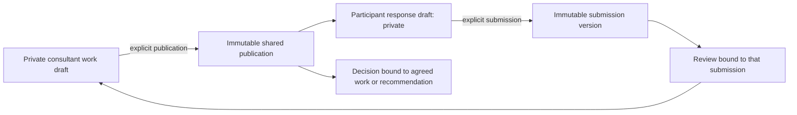

# Career Consulting service — implementation and operations

Career Consulting is an independent service domain, not a new research case type or a shortcut through Journey. Its unit of work is an agreed career question, supported by evidence, purposeful activities, shared review and a client decision. The authored practice guide explains why and when to use the tools; see `career-consulting-practice.md`.

## Access and agreement

- Root has access through its existing root flag. Other administrators receive no new permission automatically. Root grants `CAREER_CONSULTING` READ or WRITE in admin management.
- Non-root administrators also need assignment as case owner or an additional case administrator. An owner must have WRITE; an additional administrator must have READ or WRITE. Both section permission and case assignment are checked against the database on every operation, including document downloads.
- Creating a case makes an uninvited DRAFT. It creates no research consent, Journey progress, early report grant or participant notification.
- Explicit invitation makes it INVITED. The verified participant accepts the versioned service agreement in their own account. A consultant cannot accept on their behalf.
- ACTIVE + ACCEPTED is required for new work, uploads, publication, responses, reviews, comments and decisions. PAUSED, COMPLETED and WITHDRAWN are read-only. Withdrawal also revokes optional programme sharing.
- Email verification is required; a CV, portfolio or specialism is not. `/career-consulting` deliberately sits outside the programme layout, profile gate, guided tours, Journey providers and section experiments. Existing programme guards remain unchanged.

## Work and visibility

A case has a single working map and can have any number of session, activity, evidence and recommendation records. Goals may change; the software does not enforce a fixed session sequence. Publications are typed allowlisted snapshots. `privateNotes` and staff-private comments never enter the member projection. The consultant cannot read the participant’s unsubmitted response draft or unshared uploads. Sharing a PDF is explicit, either directly or through a publication/submission.

Sessions retain preparation, agenda, optional time/HTTPS meeting link, working stage and a separately published summary. Activities record a goal, reason for selection, adapted qualitative prompts and the expected output. Recommendations require reasons, alternatives, limitations and a next step. Closing a case requires a published outcome review and future steps; task count or employment is not asserted as proof of success.

Optimistic revisions reject stale edits with 409. The UI retains the editor text on failed/conflicting saves, warns about unsaved departure, and stores saved drafts on the server. Mutation request keys are bound to actor, case, action, target and content. Repeated publication of the same work version or submission of unchanged answers does not duplicate it. Reviews reference immutable submission IDs; activity changes do not rewrite earlier submissions.

## API and modules

- `src/career-consulting/catalog.ts`: original Arabic/English practice and activity content, with source chapters/pages and explicit scope limits.
- `consulting.validation.ts` and `consulting.dto.ts`: bounded typed payloads; safe prompt keys, matrix/list responses, HTTPS-only meeting links and UUID document references.
- `consulting.service.ts`: authorization, consent/state machine, private/public projections, work versions, submissions/review, decisions, timeline and retention.
- `consulting-files.service.ts`: private PDFs, queued physical deletion and conservative orphan cleanup.
- `consulting.controller.ts`: `/admin/career-consulting` and `/career-consulting`; no public case API.
- Prisma tables use the `career_consulting_` prefix. The migration adds tables, indexes and foreign keys only; it does not rewrite an existing user, research case or Journey record.

Admin endpoints provide catalog, eligible account/staff lookup, scoped cases, working items/publication, submission reviews, optional read-only programme context and case access settings. Member endpoints provide availability, own invitations/cases, self-acceptance/withdrawal, optional programme sharing, private response drafts, submissions, decisions and contextual comments. Both sides have scoped PDF upload/download and explicit sharing. Downloads are authenticated, `private, no-store`, PDF-only and `nosniff`; storage keys never appear in member responses.

The frontend folder `src/app/features/career-consulting` separates transport/types (`api.ts`), common privacy-aware rendering and PDF viewer (`shared.tsx`), case navigation (`CaseWorkspace.tsx`), consultant draft tools (`WorkingMaterial.tsx`), participant submissions and reviews (`SharedWork.tsx`), agreement/access/discussion (`CaseAccess.tsx`), practice/reference (`PracticeGuide.tsx`) and route-level coordination (`Workspace.tsx`).

The client workspace lives at `/admin/career-consulting` and `/career-consulting`. Learning and reference are inside the admin workspace. The two training scenarios at `/consulting-training/index.html` are clearly fictional, use browser-only training state and create no server records. Shared PDFs open in a contextual native dialog with a download fallback; case editors remain mounted.

## Programme resources and privacy

Only the participant can enable programme sharing. This reads their current CV, portfolio, specialism, current Journey state and aggregate application stages; it never reads CV history or edits programme records. Existing mentoring resources are read from their single source only when the administrator also has normal MENTORING permission. Programme sharing can be revoked. Case ownership is not a general COMMUNITY or MENTORING grant.

No consultation notes, answers or case identifiers are emitted to Marketing or UX Lab. Both the browser tracker and marketing ingestion reject consultation/admin routes; generic API error telemetry and browser timing observation exclude this domain. Case audit events contain action/actor/target identifiers and request fingerprints, not note/answer contents. Participant notifications use generic text and an authenticated case link.

## Storage, retention, backup and rollback

PDFs use the existing private volume under `CV_STORAGE_DIR/career-consulting/<uuid>.pdf`. They are independent of the account CV and use the existing configured file-size limit. Combined physical CV and consultation usage is enforced under the same database advisory budget lock. Operations labels describe the shared quota.

A case has an explicit retention date (default UI 90 days; maximum initial date within one year). Accepted purposes and retention cannot be silently expanded. Expired cases become inaccessible immediately; a periodic worker removes their records and queues their files. Withdrawal stops new work without extending retention. Permanent member deletion also queues consultation files before cascading case records.

`career_consulting_file_deletions` survives case deletion and retries failed physical removal. The file service only cleans its own namespace; the old flat CV cleaner rejects that namespace and ignores the directory, including files older than its grace period. A conservative scan removes unreferenced consultation files only after 24 hours, covering upload/process crashes without racing active writes.

The backup inventory validates consultation references in addition to current/history CV references. The existing full-volume archive includes the namespace, SHA-256 checksums and private permissions. The isolated restore suite includes a referenced consultation PDF and verifies unchanged database rows, user/case relationships and all file hashes. A backup is not considered recoverable until an isolated restore succeeds.

Deploy through the existing GitHub CI/release/approval/pull process: additive migration first, API then frontend. Keep previous image references. An application-image rollback does not undo the migration; keep the additive tables and all newly written case records/files. The previous API does not offer consulting and does not run its retention/deletion worker; monitor/defer pending cleanup while it is rolled back. Do not prune the private subdirectory or drop these tables to roll back UI availability. Never run reset or seed on production.

## Acceptance and safe production check

Tests cover two complete fictional career cases, unready verified participants, unverified/foreign members, non-assigned administrators, READ, private draft/note/file boundaries, consent withdrawal, immutable review linkage, retry/conflict behavior, programme isolation, quota serialization, current-CV sharing/revocation and retention/account deletion. The backup regression performs an isolated restore with consultation attachments.

Production acceptance must use the pre-existing dedicated QA member and an authorized administrator, never another participant’s data or consent. Create a clearly synthetic draft, invite, self-accept as QA, exercise shared work and files, withdraw or remove that synthetic case, and compare pre-existing research/Journey/CV invariants. Do not use a real client as a test fixture or turn an existing research Draft into a service case.

This is the qualitative consulting starting scope. It provides no standardized assessment, diagnosis, therapy, automatic career-fit score or hiring guarantee. Current market evidence needs a country and verification date. Coaching and UX Lab redesign remain separate work.
