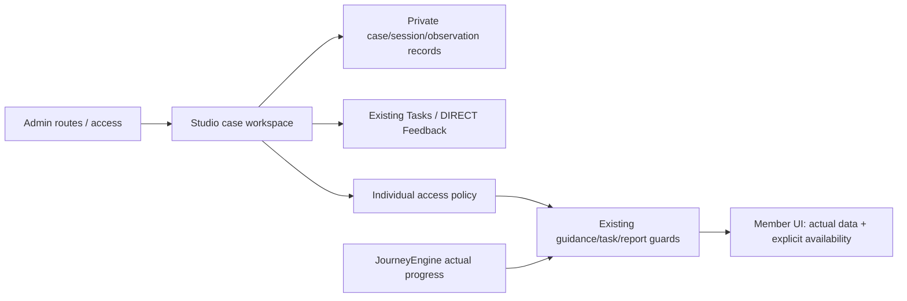

> Historical documentation: Studio P0 was retired on 2026-11-02. These endpoints and grants are no longer available. See [retirement notes](retire-studio-p0.md).

# Individual Experience Studio — تشخيص وقرار P0

## خط الأساس (1 نوفمبر 2026)

- المصدر الحالي: backend `1c275ec0a137b24576e11b0a66e81a29fce330bb`، frontend `5b7b59858d41a5bcba11005c4a504cf989765755`؛ إنشاء worktrees مستقلة بفرع `feature/individual-experience-studio-20261101` في المستودعين. توثيق المستخدم غير المحفوظ على dev تُرك كما هو.
- المساران المذكوران تحت production-release نظيفان لكنهما أقدم: backend `46132e25b3fa648b6c6480b20c5c810cca9b315b`، frontend `dc4df517fc7b1b4a7d7fd8eda78dbb32c3124da2`، وليسا دليلًا على المصدر المنشور الآن.
- الصور الحية المقروءة فقط: API `cms-back-api:nawah-marketing-reviewed-20261029`، frontend `cms-back-frontend:nawah-member-experience-20261031`. حالة الوكيل لا تحتوي commit منشورًا لهما. لا ندعي مساواة main بإنتاج قائم على tags تاريخية.
- SHA256 لـschema داخل API الحي يطابق المصدر المختار: `e5e469ac6ab6e85e2e868f6dfb9ef18543922a7c381edee8a5a60434efd60546`. فرق المصدر مع production-release يشمل الصلاحيات والمركتنج وتعديلات مهمة؛ لذلك لا نبني على checkout الإصدار القديم.

## المعمارية الحالية وإعادة الاستخدام

| الموجود | القرار |
|---|---|
| UX Lab وتجارب A/B وتعيين القسم | يبقى كما هو؛ الحالة الفردية ليست experiment في UxLabExperiment |
| JourneyEngineService وprogression listeners | لا تعديل currentNodeCode ولا كتابة إكمال من grants؛ إعادة استخدام snapshot/reporting |
| TasksService وFeedbackService | ربط موارد قائمة أو إنشاء منشور DIRECT/مهمة عبر الخدمات نفسها بإجراء نشر صريح؛ لا نظام مكرر |
| Mentoring وMemberInspector | روابط سياقية من/إلى الحالة، ولا تمنح صلاحيات MENTORING تلقائيًا |
| AdminGuard / READ / WRITE | قسم مستقل INDIVIDUAL_RESEARCH مع قيد إضافي على مالك/مصرح لهم بالحالة؛ UX_LAB وحده لا يكفي |
| Reporting utils | نفس حسابات البيانات الحقيقية؛ scope واضح للتقرير المبكر، دون بيانات demo أو اختلاق إنجاز |
| حذف الحساب | FK Cascade للحالة وبياناتها الخاصة؛ روابط المهام/Feedback لا تنسخ المحتوى الخاص |

## الفجوات وقرار البيانات

ستضاف ستة جداول: case، session، observation، plan item (يربط Task/Feedback)، access override، event. لا نضيف مرحلة عامة أو JourneyNode شخصية. خطة P0 قائمة خطوات يدوّية واضحة قابلة للمتابعة؛ فتح خطوات آليًا بناءً على الأحداث في P1.

الجلسات Consulting/Coaching/Research. الملاحظات فئات منفصلة: تصريح، ملاحظة، فرضية، إجراء، نتيجة. محور القيمة المهنية وصف/دليل: قدرة، أثر مستخدم، أثر بزنس، أو غيره؛ لا درجات نفسية. الملاحظات الخاصة لا تُرسل كـFeedback ولا تدخل UxLab/Marketing/DomainEventLog.

## سياسة الإتاحة

1. هوية/ملكية المورد/خصوصية حساب آخر/جاهزية الحساب حواجز صلبة لا تتجاوزها grants.
2. السياسة الطبيعية لا تُلغى. الـgrant يضيف VIEW أو INTERACT لمورد محدد، ولا يسجل قراءة أو إكمالًا.
3. لا تعمل grant إلا داخل حالة ACTIVE بموافقة موثقة غير مسحوبة ومدة احتفاظ سارية، وبين startsAt وendsAt. الإيقاف/الإكمال/السحب/الانتهاء/الإلغاء يعيد السياسة الطبيعية فورًا، دون مؤقت لتغيير التقدم.
4. تقارير weekly/performance/final هي VIEW فقط. final VIEW لا يسمح بـcomplete-final. Guidance VIEW لا يسمح بـmark-read؛ INTERACT فعل صريح مع بقاء شروط CV foundation الحقيقية.
5. نطاقات FEATURE الأولية محصورة: analytics، professionalTasks، tableView؛ الإرشادات المحددة عبر GUIDANCE من الكتالوج الحالي. لا توسيع لعرض أعضاء آخرين أو نسخ CV بغير قواعدها.
6. تقارير المستخدم تطلب scope محددًا، والحارس يراجع النطاق في الباك. إتاحة أسبوع لا تفتح Performance أو الأسابيع الأخرى.
7. واجهة الإتاحة ترجع source: NORMAL / ADMIN / SCHEDULED / EXPIRED / REVOKED / LOCKED؛ السبب العام لا يحتوي الملاحظات الداخلية أو hypothesis.

## الموافقة والاحتفاظ والتدقيق

الحالة تبدأ Draft. التفعيل يتطلب موافقة حقيقية موثقة وتاريخ/وسيلة ودليل مختصر وموعد حذف محدد (أقصى سنة من الآن). لا تسجيل صوت/فيديو. العضو يستطيع رؤية المشاركة وسحب الموافقة؛ السحب يلغي grants ويوقف الحالة. الحذف النهائي للحالة وصاحب الحساب يزيل سجلات البحث التابعة. عامل انتهاء الاحتفاظ يحذف الحالة دون كشف محتواها في اللوجات. READ للحالة وتعديلات/سحب/grant/revoke تسجل في جدول الأحداث الخاص. لا يُنشَر شيء للعضو إلا عبر إجراء Feedback صريح مستقل، ولا يحدث إرسال بريد افتراضي.

## التعارضات والمخاطر

- gates موزعة بين feedback، tasks، journey summary، report API وUI؛ يلزم ربطها بسياسة واحدة واختبار POST المباشر، لا مجرد أزرار.
- قراءة حالة Journey الحالية تعيد تقييم تقدم طبيعي؛ Overview البحثي يقرأ state مباشرة دون evaluateProgress.
- الأسابيع المقفولة لا تصبح مكتملة عند توسيع المشاهدة. العداد الإنجازي يستند للحالة الأصلية فقط.
- idempotency وFKs/المعاملات تمنع تكرار الربط والمهام/المنشورات عند إعادة طلب واحد.
- صورة الإنتاج لا تحمل دليل commit كامل؛ الاختبارات تستند إلى worktrees المعزولة، مع اختبارات رجوع للسلوك الحالي. لا نشر ولا migrations على الإنتاج ضمن هذا الطلب.

## التسليم والاختبار

ملف التنفيذ الختامي سيضيف API contracts ونتائج الاختبارات الفعلية والقيود وwalkthrough. تشمل الاختبارات read-only/unauthorized، مستخدم آخر، scopes، revoke/expiry/consent، فصل notes/feedback، idempotency، عدم تغيير Node/التقدم/التقارير القديمة، وحذف الحساب. قواعد أتمتة الخطة وتكامل مرصد متقدم وتحليل أثر سببي خارج P0.
